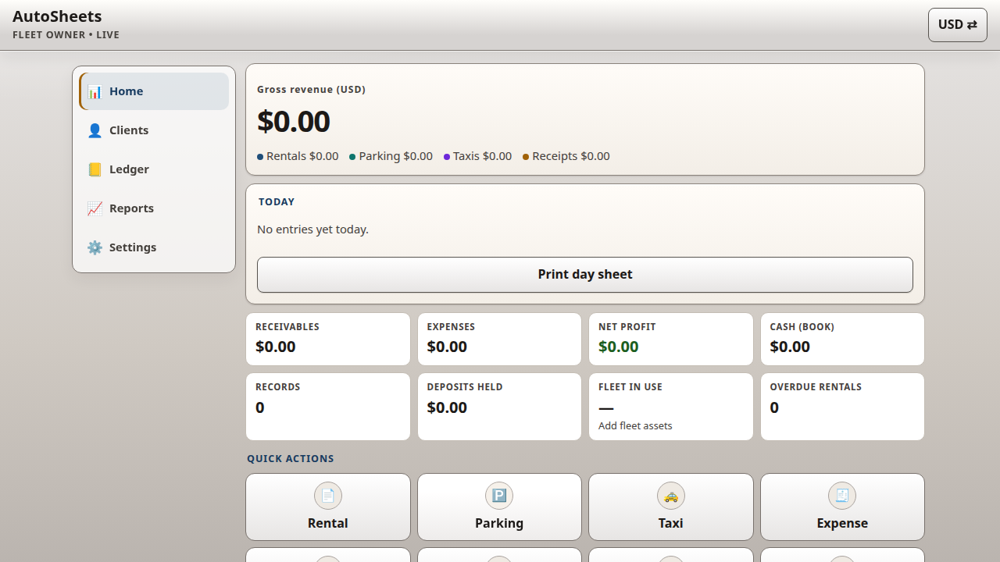

# AutoSheets

An installable car rental desk and accounting app for fleet operators. The published app stores its books in the browser and also supports parking and taxi entries.

**Live app:** [https://tajoor621.github.io/Autosheets/](https://tajoor621.github.io/Autosheets/)

<p align="center">
  
</p>

<p align="center">
  
</p>

The cash figure on the balance sheet is a running total of entries in this browser. AutoSheets does not connect to a bank.

## What you can do

- Sign in with email and password, or unlock the same browser with a 4–6 digit PIN.
- Work as Fleet Owner, Rental Desk, Parking Attendant, Dispatcher, or Accountant. Every role can use the full set of books.
- Post rental agreements, parking tickets, taxi fares, expenses, customer receipts, and vendor payments.
- Keep customers, opening balances, and a fleet list with plate, status, book value, odometer, and service due.
- Choose a book currency from USD, EUR, AED, GBP, SAR, and PKR before issuing a rental invoice. Currency selection does not convert prior amounts.
- Read a ledger with debit and credit, profit and loss, a balance sheet, customer statements, a monthly summary, and receivables aging.
- Print or share a voucher, a day sheet, profit and loss, the balance sheet, and a customer statement.
- Export a JSON backup or a CSV ledger, and import a JSON backup without changing the password or PIN.

## Car rental workflow

1. Set the book currency, company invoice address, tax registration number and default rental tax rate in Settings. The default tax rate is zero and each booking can override it. Configure rates to match your business.
2. Add vehicles and customers. Fleet records track service, registration and insurance expiry. Customer records can track driving licence expiry and a tax registration reference.
3. Open **Rentals** to check vehicle availability and reserve a pickup and return window. Use daily, weekly or monthly units, a negotiated rate, discount, included kilometres and pickup or return instructions. A reservation stays off the books until checkout.
4. At checkout, record the odometer, fuel, condition, security deposit and any first payment. AutoSheets issues the rental invoice. Print the agreement or invoice from its record.
5. Extend an open rental if the vehicle is available. At return, record the odometer, fuel and condition. Excess distance charges use the included distance and rate on the agreement. Add late, fuel, Salik, parking, traffic fine or damage charges as appropriate.
6. Record partial or full invoice payments. Refund or apply a security deposit to the amount due. Issue a credit note against an invoice and record a payment refund if it creates a customer credit.

Issued invoices and their transactions post to the journal. Rental reports include a date-filtered invoice and tax register, vehicle contribution from recorded revenue and expenses, rental cash movements and current agreement balances. Export the reports as CSV or print them. Existing rentals still open in their original entry editor. The reports treat customer receipts as collections against receivables and unassigned receipts as other income.

AutoSheets uses a single browser's books. Payment methods record money already received or sent. The web app has no shared staff accounts, online booking, payment processing, tax filing, traffic-fine feeds or bank connection. Local sign-in and PIN provide a screen lock and do not encrypt the browser data or exported backups.

Taxi commission is the driver share of the fare. The full fare is still taxi income. The driver and owner amounts are stored on the entry.

## Demo sign-in

The sign-in on the public page is a **demo only**. It is not a company account.

| Field | Value |
| --- | --- |
| Email | `owner@autosheets.com` |
| Password | `demo1234` |

A new email is saved in this browser when the password is at least 4 characters. Use a password you do not use anywhere else. Passwords and the PIN stay in `localStorage` on this device. They are not sent to a server.

## Your books stay on this device

Nothing is uploaded when you add a customer, a vehicle, or an entry. Clearing the site data for this browser deletes the books, so export a backup first.

The JSON backup includes the signed-in email and role. It does not include the password or PIN. Importing a file replaces customers, fleet, entries, rates, and the company name, and leaves sign-in and the PIN alone.

The app also installs as a standalone page and can open again from the cache when the network is down. While you are online, the page itself is loaded fresh.

## Using the pages

| Place | What it is |
| --- | --- |
| Home | Revenue, today, receivables, cash, deposits, fleet use, overdue rentals, and shortcuts |
| Rentals | Availability, reservations, inspection, documents, invoicing, payments and deposits |
| Clients | Customers and what each one owes |
| Ledger | Every entry, with search and a debit / credit total |
| Reports | Profit and loss, balance sheet, customer statement, month, aging, and rental accounting reports |
| Settings | Company name, PIN, default rates, role, export, import, and clear entries |

These addresses open the matching page after sign-in:

- [Home](https://tajoor621.github.io/Autosheets/#dashboard)
- [Rental](https://tajoor621.github.io/Autosheets/#rental)
- [Parking](https://tajoor621.github.io/Autosheets/#parking)
- [Taxi](https://tajoor621.github.io/Autosheets/#taxi)
- [Reports](https://tajoor621.github.io/Autosheets/#reports)

## Run the website locally

The site is static. From this folder:

```bash
python3 -m http.server 8765
```

Open [http://127.0.0.1:8765/](http://127.0.0.1:8765/). GitHub Pages publishes the same files from `main`. Run `node --test tests/rental-books.test.cjs` to check the rental accounting rules. `.nojekyll` keeps the asset paths as they are.

## Optional Expo app

`App.js` and `src/` are a separate React Native / Expo shell with its own sample fleet. It does not read or write the books from the website. Sign-in there is also a demo: the sample email and password are filled in so the screens can be opened. Biometric unlock is attempted on a device that has it, and otherwise the demo sign-in continues.

```bash
npm install
npx expo start
```

Node.js 18 or newer is enough for that shell. The published website does not need Node.

## Layout

```
AutoSheets/
├── index.html          # Published accounting app
├── manifest.json       # Installable app metadata
├── sw.js               # Offline cache
├── assets/             # Icon and screenshots
├── App.js              # Optional Expo shell
└── src/                # Expo screens, navigation, and sample data
```

## Rights

This repository does not include a license file. All rights remain with the copyright holder.
